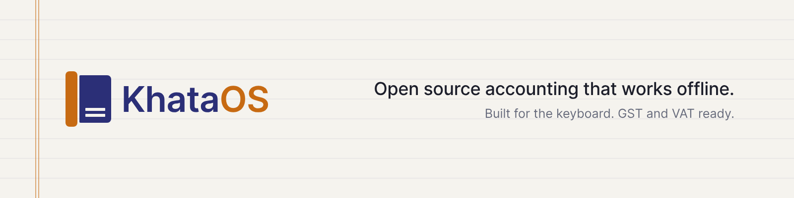

<picture>
  <source media="(prefers-color-scheme: dark)" srcset="branding/concepts/1-spine/banner-dark.png">
  
</picture>

# KhataOS

**Open-source, local-first, keyboard-first accounting.** It works like TallyPrime, so people who use Tally feel at home on day one, and it can import your Tally data. It runs on Windows, macOS and Linux, and it builds for Android and iOS from the same code.

> **Status: alpha.** Don't use it for your only set of books yet. Try it on a test company and [tell us what breaks](#try-it-and-report-issues).

**New here?** Read the [user guide](docs/guide/README.md): [install](docs/guide/install.md), [create your first company](docs/guide/first-company.md), and, if you use Tally today, [coming from Tally](docs/guide/coming-from-tally.md).

## What it is

- **Your books are a file on your device.** One SQLite file per company. It works offline. Nothing goes to a server unless you choose to share.
- **An audit trail that is always on.** Every change is a hash-chained entry, and the database rejects edits to history. The trail *is* the storage format, so it can't be switched off, and any copy can rebuild the books from it.
- **Keyboard-first, with Tally-compatible shortcuts.** F4–F9 for voucher types, Alt+G for Go To, Ctrl+A to accept, the single-letter home menu keys, and so on. See the [key reference](docs/guide/keyboard.md). The key map is data, so it can be remapped (there is no settings screen for it yet). The mouse and touch work too.
- **Sharing without pen drives.** An office server on the LAN, an end-to-end encrypted relay over the internet, or a sealed `.khatapkg` file for your accountant. See [`docs/sharing.md`](docs/sharing.md).
- **Country rules in compliance packs.** The ledger engine knows no country. Each country's tax rules live in their own crate.
- **English and Arabic**, with a full right-to-left layout (Ctrl+K). See [`docs/i18n.md`](docs/i18n.md).

Accounting covers masters, vouchers, bill-wise tracking, inventory (godowns, batches, valuation), bank reconciliation and statement import, cheque and invoice printing, users and roles, Day Book, ledgers, Trial Balance, P&L, Balance Sheet, outstanding, ageing, ratio analysis, PDF and CSV export, foreign-currency invoices, an accountant's desk for due dates and to-dos, a calculator panel, and import from Tally's XML export. The [roadmap](docs/roadmap.md) lists what isn't there yet.

## Countries

The launch markets are **India, UAE, Saudi Arabia, Singapore and the UK**. Packs for Germany, France, the Netherlands, Spain, the US and Mexico are also in the app, and they're less mature.

All the figures are a preparation aid: check them with your accountant before you file. Status key:

- **Live-tested**: run end to end against the authority's official test service.
- **Mock-only**: the connector is built, but it has only been tested against a local mock of the documented API. It needs a tester with real credentials.
- **Needs official validation**: the file or return is generated in the app, but it hasn't been checked with the official validator or tool yet.

| Country | In the app | Connection to the authority | Status |
|---|---|---|---|
| India | GSTIN checks, CGST/SGST/IGST from place of supply, Rule 46 numbering, GSTR-1 and GSTR-3B, GSTR-2B reconciliation, reverse charge and ITC, TDS/TCS, Schedule III. [GST returns](docs/india-gst-returns.md), [TDS](docs/india-tds.md), [Schedule III](docs/india-schedule-3.md) | e-Invoice (IRN) through an IRP. [e-Invoice](docs/einvoice.md) | IRP: **mock-only**. GSTR-1 JSON, e-invoice and e-way bill JSON, and the TDS statement file: **needs official validation** (Returns Offline Tool, FVU). |
| UAE | TRN checks, 5% VAT, VAT 201, PINT AE e-invoice XML. [UAE VAT](docs/uae-vat.md) | Peppol Access Point (generic). [Peppol](docs/peppol.md) | Access Point: **mock-only**. PINT AE XML: **needs official validation** (Schematron). |
| Saudi Arabia | VAT number checks, 15% VAT, the VAT return, bilingual invoices, ZATCA Phase 2 e-invoices (hash chain, QR, XAdES stamp). [KSA and ZATCA](docs/ksa-zatca.md) | ZATCA onboarding, clearance and reporting | **Live-tested** on ZATCA's developer-portal sandbox. Not yet run against simulation or production, which need a real taxpayer's OTP. |
| Singapore | GST registration number checks, GST with its rate history, GST F5, PINT SG e-invoice XML. [Singapore GST](docs/singapore-gst.md) | InvoiceNow through a Peppol Access Point. [Peppol](docs/peppol.md) | Access Point: **mock-only**. PINT SG XML: **needs official validation** (Schematron). |
| UK | VAT number check digits, 20/5/0% VAT, reverse charge, VAT schemes, the 9-box return. [UK VAT](docs/uk-vat.md) | Making Tax Digital (MTD) VAT API | **Mock-only**: needs a registered HMRC developer application. |
| Germany | USt-IdNr and Steuernummer checks, 19/7% USt, §13b, UStVA, XRechnung 3.0. [Germany](docs/germany-vat.md) | None (nothing is sent to ELSTER) | **Needs official validation** (KoSIT validator). |
| France | TVA number, SIREN and SIRET checks, TVA with DOM rates, CA3, Factur-X. [France](docs/france-vat.md) | None | **Needs official validation**. |
| Netherlands | btw-id checks, 21/9/0% btw, btw verlegd, aangifte omzetbelasting. [Netherlands](docs/netherlands-vat.md) | None | **Needs official validation**. |
| Spain | NIF checks, 21/10/4% IVA, modelo 303, VeriFactu records. [Spain](docs/spain-vat.md) | None (nothing is sent to the AEAT) | **Needs official validation**. |
| US | EIN/SSN/ITIN formats, sales tax from the jurisdictions you set up, nexus warning, use tax, exemption certificates, the Form 1099 list. [US](docs/us-sales-tax.md) | None | **Needs official validation**. |
| Mexico | RFC checks, IVA, CFDI 4.0 with the CSD sello, payment receipts, monthly IVA summary. [Mexico](docs/mexico-cfdi.md) | PAC timbrado (SW Sapien adapter) | PAC: **mock-only**. CFDI XML: **needs official validation**. |

EN 16931 e-invoices (UBL and CII, XRechnung, Peppol BIS Billing 3.0, Factur-X) come from a shared crate. See [`docs/en16931.md`](docs/en16931.md).

## Download

There are no release builds yet. Until there are, build from source. The [install guide](docs/guide/install.md) has the steps for each system.

## Build from source

You need:
- Rust 1.85 or newer (edition 2024), from [rustup](https://rustup.rs);
- Node 22 and [pnpm](https://pnpm.io);
- on macOS, the Xcode command-line tools;
- on Linux, the WebKitGTK packages Tauri lists, for example on Ubuntu:
  `sudo apt-get install libwebkit2gtk-4.1-dev libappindicator3-dev librsvg2-dev patchelf`.

Then:

```sh
git clone https://github.com/khataos/khataos.git
cd khataos/apps/desktop
pnpm install
pnpm app:dev        # tauri dev with Vite hot reload
```

`pnpm app:dev` is `pnpm tauri dev` with the dev config (`src-tauri/tauri.dev.conf.json`). To build an installer for your OS, run `pnpm app:build`.

**Android and iOS:** the phone apps are this same app built with Tauri's mobile support. Android debug APKs build, and iOS builds with `pnpm tauri ios build`. See [`docs/mobile.md`](docs/mobile.md) for the setup.

**Sync server:** to run your own (the accountant portal is at `/portal`):

```sh
KHATA_ADMIN_KEY="$(openssl rand -hex 32)" KHATA_DATA_DIR=./khata-data cargo run -p khata-server
```

To host a relay, see [`docs/deploy-relay.md`](docs/deploy-relay.md).

## Try it and report issues

We need accountants, CAs, bookkeepers and businesses to try KhataOS and tell us where it's wrong, slow or confusing, especially if you know TallyPrime well.

1. Read the tester guide: [`docs/testing.md`](docs/testing.md), and keep the [user guide](docs/guide/README.md) open while you try things.
2. Create a **new test company**. Never open a real company file or real customer data in an alpha.
3. Report what you find with the [issue forms](https://github.com/khataos/khataos/issues/new/choose): a bug, a wrong tax rule (with the official source), or general tester feedback.

## Contributing

Contributions are welcome: code, tax-rule checks, translations and testing. Read [`CONTRIBUTING.md`](CONTRIBUTING.md) first. In short:

- run `cargo test --workspace`, `cargo clippy --workspace --all-targets -- -D warnings`, and `pnpm typecheck` in `apps/desktop`;
- country rules go in a compliance pack, never the core, and tax rules cite a primary source;
- sign off your commits (`git commit -s`).

Everyone taking part follows the [Code of Conduct](CODE_OF_CONDUCT.md).

## Security

Please don't report vulnerabilities in public issues. Use [GitHub's private vulnerability reporting](https://github.com/khataos/khataos/security/advisories/new). See [`SECURITY.md`](SECURITY.md).

## Workspace

| Crate | What it does |
|---|---|
| [`khata-core`](crates/khata-core) | Country-neutral double-entry engine: chart of accounts with Tally-style default groups, vouchers, bill-wise allocations, inventory, and an audit trail that is always on, hash-chained and replayable. Core reports. |
| [`khata-store`](crates/khata-store) | One SQLite file per company. The audit trail is the storage format, and triggers keep it append-only. |
| [`khata-sync`](crates/khata-sync) | Client sync: fast-forward push and pull, `rebase` for concurrent offline edits, sealed relay sync and moving relays. |
| [`khata-server`](crates/khata-server) | Self-hostable sync server and blind relay (axum). It validates every push and has owner, accountant and viewer tokens that can expire. Includes the read-only accountant portal. |
| [`khata-seal`](crates/khata-seal) | End-to-end encryption (XChaCha20-Poly1305 with Argon2id) for relay entries and file packages. |
| [`khata-package`](crates/khata-package) | Encrypted, verified `.khatapkg` update files for sharing books without a server. |
| [`khata-keymap`](crates/khata-keymap) | Key bindings as data. The TallyPrime 7.x-compatible default map, resolved by screen context and remappable. |
| [`khata-import-tally`](crates/khata-import-tally) | Import from Tally's documented XML export: groups, ledgers, inventory masters, opening balances and vouchers, with a report of anything skipped. |
| [`khata-print`](crates/khata-print) | Print-ready A4 HTML (save as PDF) and CSV for reports and invoices, including bilingual Arabic/English invoices. |
| [`khata-compliance`](crates/khata-compliance) | The `CompliancePack` interface: financial year, currency, regions, tax-ID and invoice-number checks, tax on a line, and effective-dated rate schedules. |
| [`khata-in`](crates/khata-in) | India: GSTIN, place of supply, GST, GST returns, e-invoice and e-way bill JSON, the IRP client protocol, TDS/TCS, Schedule III. |
| [`khata-ae`](crates/khata-ae) | UAE: TRN, emirates, 5% VAT, VAT 201. |
| [`khata-sa`](crates/khata-sa) | Saudi Arabia: VAT number, regions, 15% VAT, VAT return, ZATCA UBL XML, hash chain, QR, CSR and XAdES stamp. |
| [`khata-sg`](crates/khata-sg) | Singapore: GST registration numbers, GST rate history, GST F5. |
| [`khata-gb`](crates/khata-gb) | UK: VAT numbers (HMRC check digits), the four nations, 20/5/0% VAT, the 9-box return and MTD body, fraud-prevention headers. |
| [`khata-de`](crates/khata-de) | Germany: USt-IdNr and Steuernummer, Bundesländer, USt with §13b, UStVA, XRechnung and Leitweg-ID. |
| [`khata-fr`](crates/khata-fr) | France: numéro de TVA, SIREN/SIRET, régions with DOM rates, TVA with autoliquidation, CA3. |
| [`khata-nl`](crates/khata-nl) | Netherlands: btw-id and omzetbelastingnummer, provinces, btw with verlegging, the aangifte rubrieken. |
| [`khata-es`](crates/khata-es) | Spain: NIF, comunidades, IVA with inversión del sujeto pasivo, modelo 303, VeriFactu records. |
| [`khata-us`](crates/khata-us) | US: EIN/SSN/ITIN, states, company-defined sales tax jurisdictions, nexus, use tax, exemption certificates, Form 1099. |
| [`khata-mx`](crates/khata-mx) | Mexico: RFC, federal entities, IVA, CFDI 4.0 with cadena original and sello, withholdings, Complemento de Pagos. |
| [`khata-en16931`](crates/khata-en16931) | Country-neutral EN 16931 e-invoice model and rules, UBL 2.1 and CII writers (EN 16931, XRechnung, Peppol BIS), Peppol PINT SG/AE and Factur-X PDF/A-3. |
| [`apps/desktop`](apps/desktop) | The Tauri 2 app (desktop, Android, iOS): Rust commands in `src-tauri/src`, a Vite + TypeScript frontend in `src`. The country packs it ships are listed in `src-tauri/src/packs.rs`. |

## Docs

All the documentation is listed in [`docs/README.md`](docs/README.md).

- [User guide](docs/guide/README.md): task-based pages for every screen, with the exact keys. Start with [Coming from Tally](docs/guide/coming-from-tally.md) if you know TallyPrime.
- [Key reference](docs/guide/keyboard.md): every key, generated from the key map.
- [`docs/architecture.md`](docs/architecture.md): how the pieces fit together, and the security model.
- [`docs/roadmap.md`](docs/roadmap.md): what works today, and what's next.
- [`docs/ux/interaction-spec.md`](docs/ux/interaction-spec.md): keyboard and screen behaviour rules.
- [`docs/sharing.md`](docs/sharing.md): office server, relay and accountant files.
- [`docs/mobile.md`](docs/mobile.md): Android and iOS.
- [`docs/research/`](docs/research): Tally pain points, the key map, and compliance research per country.

## Clean-room policy

KhataOS reproduces **behaviour** that users rely on, such as workflows and key bindings. It doesn't copy TallyPrime's code, screens, text, icons or branding. Data migration uses Tally's published XML interface only.

## Licence

KhataOS is free software under the **GNU Affero General Public License v3.0 or later** ([`LICENSE`](LICENSE)). You can use, study, change and share it. If you run a modified version as a network service, such as a hosted sync server or accountant portal, you must offer its users the source of your changes.

Copyright © 2026 the KhataOS contributors.

## Trademarks

"Tally", "TallyPrime" and "Tally.ERP 9" are trademarks of Tally Solutions Pvt. Ltd. KhataOS is an independent project. It is not affiliated with, endorsed by or sponsored by Tally Solutions. The names are used only to describe compatibility, such as the key map and data import. Other product and authority names belong to their owners.
