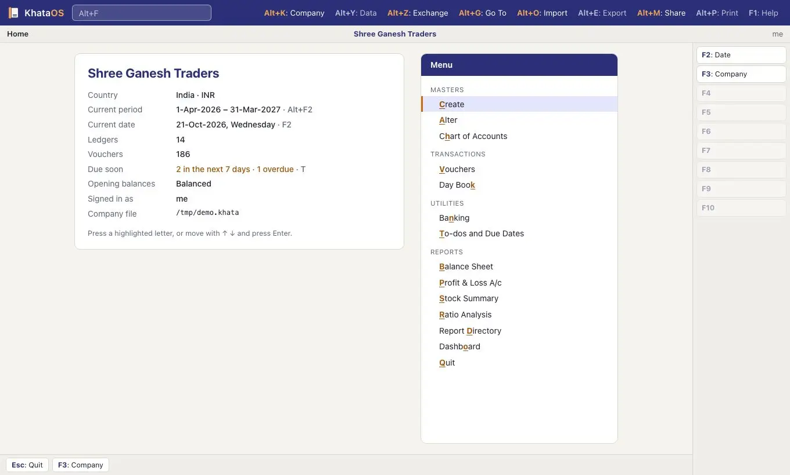

<div class="kd-hero" markdown>


**Open source accounting that works offline.**

[Download KhataOS](download.md)

</div>

# KhataOS documentation

KhataOS is free, open source accounting software. It works offline, keeps your books on your own computer, is built for the keyboard, and uses the keys Tally users know. It handles GST in India, VAT and ZATCA e-invoicing in the UAE and Saudi Arabia, and UK Making Tax Digital, and runs on Windows, macOS, Linux and Android. This page lists all the documentation.



## For people using KhataOS

The **[user guide](guide/README.md)** has short pages, one for each task, with the exact keys:

- Getting started: [Download](download.md) · [Install](guide/install.md) · [Your first company](guide/first-company.md) · [Coming from Tally](guide/coming-from-tally.md) · [Keyboard](guide/keyboard.md)
- Everyday work: [Masters](guide/masters.md) · [Vouchers](guide/vouchers.md) · [Reports](guide/reports.md) · [Invoices](guide/invoices.md) · [Desk](guide/desk.md) · [Calculator](guide/calculator.md)
- Countries: [India](guide/gst-india.md) · [UAE and Saudi Arabia](guide/vat-gulf.md) · [UK](guide/uk.md) · [Singapore](guide/singapore.md) · [Germany, France, Netherlands, Spain](guide/europe.md) · [US](guide/us.md) · [Mexico](guide/mexico.md)
- Working with others: [Sharing](guide/sharing.md) · [Import from Tally](guide/import-from-tally.md)
- Your data: [Backup](guide/backup.md) · [Arabic](guide/arabic.md) · [Mobile](guide/mobile.md) · [Troubleshooting](guide/troubleshooting.md) · [FAQ](guide/faq.md)

Testers: start with the [tester guide](testing.md).

## Country reference

Detailed notes on each compliance pack: the rules, the sources behind them, what was tested and what is still open.

| Country | Docs |
|---|---|
| India | [GST returns](india-gst-returns.md) · [TDS and TCS](india-tds.md) · [Schedule III](india-schedule-3.md) · [e-Invoice and e-way bill](einvoice.md) |
| UAE | [UAE VAT](uae-vat.md) |
| Saudi Arabia | [KSA VAT and ZATCA](ksa-zatca.md) |
| Singapore | [Singapore GST](singapore-gst.md) |
| UK | [UK VAT and MTD](uk-vat.md) |
| Germany | [Germany](germany-vat.md) |
| France | [France](france-vat.md) |
| Netherlands | [Netherlands](netherlands-vat.md) |
| Spain | [Spain](spain-vat.md) |
| US | [US sales tax](us-sales-tax.md) |
| Mexico | [Mexico CFDI](mexico-cfdi.md) |
| E-invoicing | [EN 16931](en16931.md) · [Peppol](peppol.md) |

## Features in depth

- [Invoice design](invoice-design.md): templates, logos, the PDF writer.
- [Multiple currencies](multi-currency.md): ledgers and vouchers in foreign currencies, and forex gain or loss.
- [Languages](i18n.md): Arabic, the right to left layout, Hijri dates, adding a language.
- [Sharing your books](sharing.md): office server, relay, accountant files.
- [Android and iOS](mobile.md): building and running the phone apps.
- [Crash reporting](crash-reporting.md): what a report contains and how it is sent.

## For developers and contributors

- [Contributing](../CONTRIBUTING.md), [Code of Conduct](../CODE_OF_CONDUCT.md), [Security](../SECURITY.md).
- [Architecture](architecture.md): how the crates fit together, the audit trail, the security model.
- [Roadmap](roadmap.md): what works today and what's next.
- [Testing](testing.md): the tester guide.
- [Hosting a relay](deploy-relay.md): running `khata-server` as a relay.
- [Interaction spec](ux/interaction-spec.md): the keyboard and screen rules every screen follows.
- [Desktop app](../apps/desktop/README.md): the Tauri app's layout and build.
- The key reference in [Keyboard](guide/keyboard.md) is generated from `crates/khata-keymap/src/tally.rs`. After changing the key map, run `scripts/keymap-doc`; a test fails until you do.

## Research

Background studies in `docs/research/`. They are planning inputs, written at a point in time, and may lag the code.

- Tally gap studies: [accounting](research/tally-gap-accounting.md) · [inventory, payroll and tax](research/tally-gap-inventory-payroll-tax.md) · [user experience and platform](research/tally-gap-ux-platform.md)
- Tally: [pain points](research/tally-pain-points.md) · [shortcuts](research/tally-shortcuts.md)
- [Voucher numbering](research/voucher-numbering.md) · [Accountant's desk](research/accountant-desk.md)
- Compliance: [India](research/india-compliance.md) · [India GST advanced](research/india-gst-advanced.md) · [India TDS and TCS](research/india-tds-tcs.md) · [India Schedule III](research/india-schedule-3.md) · [UAE and KSA](research/mena-compliance.md) · [Singapore](research/singapore-compliance.md) · [UK](research/uk-compliance.md) · [Germany](research/germany-compliance.md) · [France](research/france-compliance.md) · [Netherlands](research/netherlands-compliance.md) · [Spain](research/spain-compliance.md) · [US](research/us-compliance.md) · [Mexico](research/mexico-compliance.md) · [E-invoicing and Peppol](research/einvoicing-peppol.md)

## The docs site

The docs can be published as a website with [MkDocs](https://www.mkdocs.org) and the Material theme. The configuration is [`mkdocs.yml`](../mkdocs.yml) at the repository root, and [`.github/workflows/docs.yml`](../.github/workflows/docs.yml) builds the site on every push to `main` that touches the docs, and on pull requests.

**Publishing is off until a maintainer enables it in the repository settings:**

1. Settings → Pages → Build and deployment → Source: **GitHub Actions**.
2. Settings → Secrets and variables → Actions → Variables: add `DOCS_PAGES` with the value `true`.

The next push to `main` then deploys the site to GitHub Pages. Until then the workflow only checks that the site builds.

To preview locally:

```sh
python3 -m venv .venv
.venv/bin/pip install mkdocs-material==9.5.49
.venv/bin/mkdocs serve
```

Then open http://127.0.0.1:8000. Links to source files outside `docs/` work on GitHub but not on the site.
